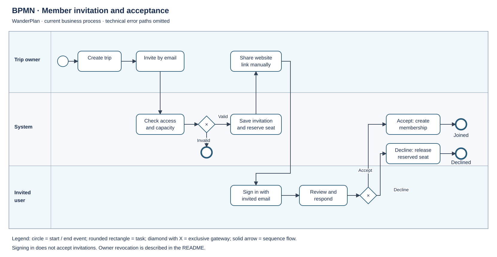
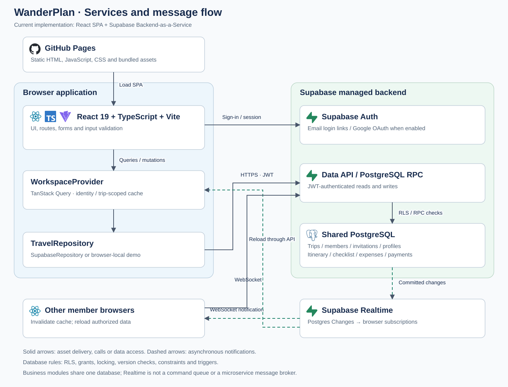
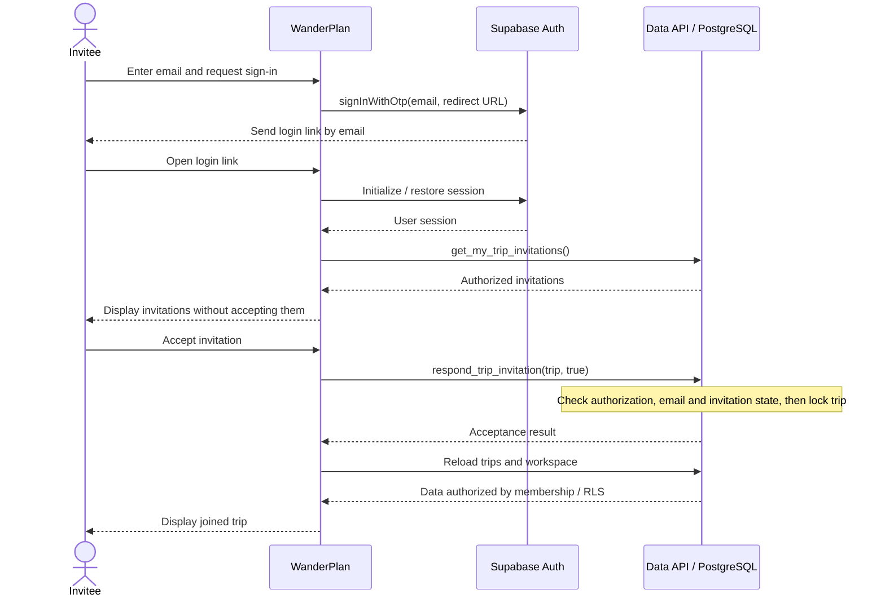
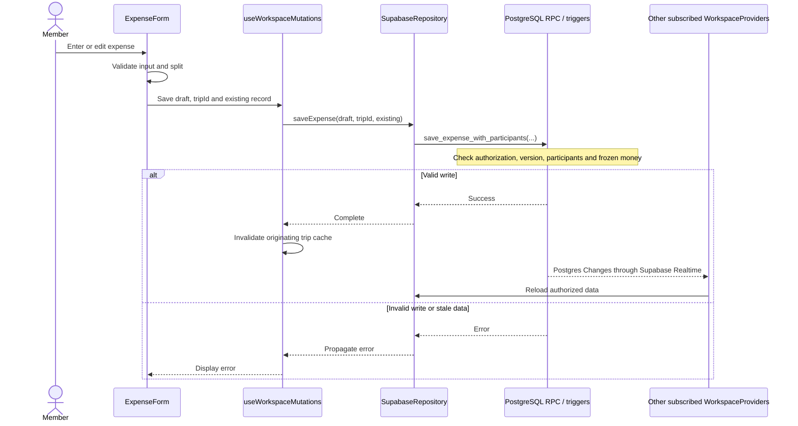

# WanderPlan

WanderPlan is a collaborative travel-planning web application for trips, itineraries, members, shared checklists and expenses. Members collaborate through Supabase; demo mode stores data privately in the browser.

For development across devices or coding agents, start with [the shared project handoff](docs/agent/README.md). It links the delivery workflow, current tracker, decisions and verification evidence committed with the code.

## Business capabilities

| Role | Capabilities |
| --- | --- |
| Signed-out user | Sign in with an email link or Google when enabled; account creation follows the access policy |
| Signed-in user | Create trips and accept or decline invitations addressed to their email |
| Trip member | View and edit itineraries, expenses and checklists; review balances and manage their own display name |
| Trip owner | All member capabilities, plus trip settings, invitations, eligible member removal, archiving and restoration |
| Payment recipient | Record or undo receipt of a payment, subject to membership and payment-history rules |

Signing in does not accept invitations. Pending invitations reserve capacity. A member can be removed only after settling their balance and resolving any estimate-only expenses involving them. Once a member leaves, the financial fields of related expenses are frozen to preserve history.

Expenses support equal splits, shares and exact amounts. Balances account for expenses and recorded payments. WanderPlan records payments; it does not transfer money. Archiving hides trip contents while retaining data for owner restoration.

### BPMN: member invitation and acceptance



This BPMN diagram uses one process pool with three responsibility lanes: trip owner, system and invitee. Solid arrows are sequence flows, circles are events, rounded rectangles are tasks, and diamonds marked X are exclusive gateways. Technical error paths are omitted to focus on the business process.

The owner creates a trip and invites an email address. The system checks authorization and capacity before saving an invitation that reserves a seat. The owner manually shares the website link; WanderPlan does not send invitation emails. The invitee signs in with the matching email and explicitly accepts or declines. Declining or owner revocation releases the reserved seat; signing in alone does not create membership.

ICS export creates a calendar event; it does not provide background notifications or reminder emails.

## Architecture and technology stack

The frontend is a React/TypeScript SPA built by Vite and served as static assets on GitHub Pages. This repository has no separate application server. The browser calls Supabase Auth, Data API/RPC and Realtime; PostgreSQL enforces RLS, function permissions, triggers and business rules.

### Services and message flow



The diagram uses service blocks and message flows similar to a message-driven architecture. The implemented model is **SPA + Supabase Backend-as-a-Service**, backed by shared PostgreSQL. Business modules represent tables and functions/RPCs within that database, rather than independently deployed microservices. Supabase Realtime delivers database-change notifications to browsers rather than coordinating business commands between services.

**Solid arrows:** asset delivery, calls or data access. **Dashed arrows:** asynchronous change notifications. Following a successful write, the initiating browser invalidates its cache; other connected sessions receive notifications and reload authorized data. The system does not implement a command queue, event sourcing or a separate database per service.

Technology logos are embedded in the SVG so the diagram works without external image requests. Logo sources and attribution are listed in [the diagram assets documentation](docs/diagrams/README.md).

| Component | Source / responsibility |
| --- | --- |
| Bootstrap and routing | `src/main.tsx`, `src/App.tsx`, `src/components/AppShell.tsx`; dashboard, itinerary, expenses and group routes |
| Authentication | `src/providers/AuthProvider.tsx`, `src/pages/LoginPage.tsx`; sessions, sign-in/sign-out and callback errors |
| Workspace and cache | `src/providers/WorkspaceProvider.tsx`, `src/hooks/useWorkspace.ts`; trip selection, queries/mutations and one Realtime channel at a time |
| Data access | `src/services/travelRepository.ts`; shared interface for SupabaseRepository and DemoRepository |
| Types and calculations | `src/types.ts`, `src/lib/expenseSettlement.ts`; application data, expense splits and settlement |
| Import/export | `src/lib/travelExcel.ts`, `src/lib/xlsxGuard.ts`, `src/lib/tripReminder.ts`; Excel and ICS calendar files |
| Database | `supabase/migrations/`; schema, RLS, RPCs, locking and integrity checks |
| Testing | Vitest + Testing Library; pgTAP on embedded PostgreSQL or full Supabase |
| Build and hosting | `.github/workflows/ci.yml`, `.github/workflows/deploy-pages.yml`; verification before Pages deployment |

Core tables include `profiles`, `trips`, `trip_members`, `trip_invitations`, `itinerary_items`, `expenses`, `expense_participants`, `checklist_items` and `settlement_payments`. The `private` schema holds internal helpers and settings. The current schema is the result of the migration chain, rather than just the initial migration.

Caches are scoped to account and trip. Account changes reset the workspace; trip changes reset page forms. Late mutation results refresh the originating trip cache. Realtime prompts data reloads and does not replace database authorization. Demo data does not automatically synchronize across browsers or devices.

### Sequence: sign-in and invitation acceptance

This sequence shows successful email sign-in. Google OAuth is an alternative when configured. Supabase Auth sends login emails; creating a WanderPlan invitation does not send an invitation email.



### Sequence: saving an expense and notifying collaborators

Expense writes illustrate RPC usage; some other operations use the Data API directly under RLS/triggers. UI validation supports data entry; the database decides whether a write is valid.



## Development

Use Node 20.19+ or a supported newer LTS. Install dependencies from the lockfile and start the Vite development server:

```sh
npm ci
npm run dev
```

Open `http://localhost:5173/wander-plan/`, or use the port printed by Vite if 5173 is occupied. Stop the server with `Ctrl+C`. Run verification commands separately:

```sh
npm test
npm run lint
npm run build
```

To connect Supabase, copy `.env.example` to `.env.local`, set `VITE_SUPABASE_URL` and `VITE_SUPABASE_PUBLISHABLE_KEY`, and keep `VITE_DEMO_MODE=false`. Keep `.env.local` and secret/service-role keys out of Git. Configure the database and Auth as described below.

Without Supabase configuration, development uses browser-local demo data. `VITE_DEMO_MODE=true` explicitly selects demo even when Supabase variables exist. Demo data is private to that browser; no emails or collaboration. Existing demo data is preserved when first writing the multi-trip storage format.

## Database setup and upgrades

Fresh database: apply all files in `supabase/migrations/` once in filename order. Existing databases: inspect applied migration history and apply only missing forward migrations. Do not rerun all historical migrations: earlier functions restore obsolete single-trip/auto-accept behavior. Keep a backup and rehearse upgrades before production.

The `202610150001` security migration removes direct membership INSERT privileges from public API roles. Trip creation and recipient acceptance still create memberships through their authorized RPCs; existing memberships and business data are unchanged. Apply this forward migration to databases already running the `202610140004` contract. Do not restore the old direct INSERT grant when reverting frontend code.

The `202610160001` migration rejects moving an expense to another trip while any existing participant is not a member of the destination trip, matching the rule already applied when participants are saved. Same-trip edits and existing data are unchanged; apply it once as a forward migration.

The `202610160002` migration adds an optional expense `end_date` for round-trip transport (return date) and stays (check-out date); amounts still count on `expense_date`. It replaces `save_expense_with_participants` with a version that takes a trailing `target_end_date` and updates `import_trip_data`. Apply it before the matching frontend. An older frontend editing a ranged expense clears its end date, so prefer a forward fix over reverting the frontend once ranged expenses exist.

### Existing column error after a manual deployment

`42701: column "revoked_at" already exists` while applying `202610140004` can mean its SQL was applied through SQL Editor but its version is absent from `supabase_migrations.schema_migrations`. Check `npx supabase migration list` against the intended project and compare the entire migration's functions, columns, constraints, policies, triggers and privileges with the deployed database. An existing column alone does not prove the migration is complete.

For the verified WanderPlan production database, the missing history entries were repaired on 15 October 2026 with:

```sh
npx supabase migration repair 202610140004 202610150001 --status applied --project-ref rpwchohopxvqsftrould
npx supabase migration list --project-ref rpwchohopxvqsftrould
npx supabase db push --linked --project-ref rpwchohopxvqsftrould --dry-run --skip-vault
```

These repair commands record already-applied versions without rerunning their SQL. Do not run them against another database unless both migrations are fully verified there. Do not drop existing columns, reset the database, or add only `IF NOT EXISTS` to bypass this error. If a migration was only partly applied, reconcile that difference before marking it applied. Prefer the normal migration runner for future releases; after any manual SQL deployment, verify and reconcile its history before the next push. See the [official migration repair reference](https://supabase.com/docs/reference/cli/supabase-migration-repair).

The new `202610140004` migration supports explicit invitation responses, revocation, reserved capacity, and idempotent multi-trip creation. Preserve `202610140003_remove_trip_member.sql` as part of the upgrade chain too. Deploy the new schema before the matching frontend; an older frontend cannot display incoming invitations once automatic claiming is disabled. Coordinate the rollout and verify sign-in, acceptance, revocation, trip selection and expenses before inviting real users.

With Docker Desktop available:

```sh
npm run supabase:start
npm run test:db
npm run supabase:stop
```

Without Docker, an ephemeral embedded PostgreSQL runner applies the unchanged migrations and runs all pgTAP suites:

```sh
npm run test:db:embedded
```

This verifies SQL and RLS with a minimal Supabase identity bootstrap. It does not verify email delivery, Supabase Realtime delivery or concurrent database sessions; those require the full Supabase stack/staging verification.

## Supabase Auth and deployment

Keep Email Auth enabled. Set Site URL and allowed redirect URL to `https://dtkien-dev.github.io/wander-plan/`; also allow the exact local development URL when testing sign-in locally. Copy `.env.example` to `.env.local` and set the project URL and publishable key. Configure the same `VITE_SUPABASE_URL` and `VITE_SUPABASE_PUBLISHABLE_KEY` repository variables for GitHub Pages. Never expose a secret/service-role key. Production fails closed if configuration is missing unless demo mode is explicitly enabled.

Users sign in with an email link. Sign-in does not accept invitations. The recipient sees pending invitations and chooses accept or decline after authenticating with the matching email. Existing accepted memberships are preserved. Creating an invitation stores it inside WanderPlan; it does not send an invitation email. The owner shares the website link and asks the recipient to sign in with the invited address. Login-link delivery is handled by Supabase Auth; verify the configured mail sender separately before public use.

The `202610160004` migration accepts only https Google Maps links in itinerary items (existing rows must already comply; check before applying), removes EXECUTE on application functions from signed-out callers and makes new functions private by default. Grant EXECUTE to `authenticated` explicitly for any new RPC.

### New-account switch and Google sign-in

`config/access.json` holds two switches:

- `allowNewAccounts`: `false` lets only existing accounts and emails with a pending invitation create an account; `true` lets anyone sign up. Supabase enforces it through the `before-user-created` hook (`public.hook_before_user_created`, migration `202610160003`) for both email links and Google. Existing accounts are never blocked.
- `googleSignIn`: shows the "Sign in with Google" (translated UI label) button. It does not enable the provider; turn it on only after Google is configured in Supabase.

Changing `allowNewAccounts`: edit the file, commit and push, then apply it to the database (the CLI must be logged in to the project):

```sh
npm run access:apply -- --project-ref rpwchohopxvqsftrould
```

Use `--local` for the local stack. The script prints the stored value; a push alone does not change the database.

One-time project setup by the owner in the Supabase dashboard:

1. Authentication → Auth Hooks → Before User Created → Postgres function `public.hook_before_user_created`. Until this hook is enabled the switch is stored but not enforced.
2. For Google: create an OAuth client (type Web application) in Google Cloud Console with authorized JavaScript origin `https://dtkien-dev.github.io` and authorized redirect URI `https://rpwchohopxvqsftrould.supabase.co/auth/v1/callback`. Then enable Authentication → Providers → Google with its client ID and secret. Keep `https://dtkien-dev.github.io/wander-plan/` in the allowed redirect URLs. Never commit the client secret.

Locally, `supabase/config.toml` enables the same hook. Google stays disabled there unless `SUPABASE_AUTH_EXTERNAL_GOOGLE_CLIENT_ID` and `SUPABASE_AUTH_EXTERNAL_GOOGLE_SECRET` are set and `enabled` is switched on before `supabase start`.

Pending invitations reserve places: 3 active members plus 1 pending invitation fill a group of 4. The owner can revoke the pending invitation to free its place. A declined invitation also frees its place. There is no automatic expiry policy in this version.

## Trips and reminders

The Group page shows a compact trip summary above members and the shared checklist. Owners open **Edit trip** to edit settings; **Increase member limit** opens the same editor with capacity focused. Cancelling discards the draft when reopened. Expand **Your display name** for your profile, or **Manage archived trips** for owner archive controls. Tablet/mobile layouts use a single content column and bottom navigation.

Owners can archive the current trip from **Group → Archive this trip** after confirmation. Archived itinerary, expenses, checklist and invitations are hidden at the API boundary for every member until an owner restores the trip from **Archived** beside the trip selector. Restoration works even when all trips are archived. Only the owner's minimal archived-trip list exposes the title and restoration metadata; members cannot restore. Existing data, memberships and pending invitations are retained.

The owner can remove a member only after that member is settled: no debt, nothing owed to them, and no expense without an actual amount involving them. Old expenses keep removed members as "(former member)"; their money (amounts, split, payer, participants) is frozen and they cannot be deleted, while title, category, dates and notes stay editable. Apply `20261016240000_lock_former_member_money.sql` before deploying frontend 0.9.2. Apply `20261016230000_settled_member_removal.sql` before deploying frontend 0.9.1.

Each expense has **Split method**: equal (default), by shares or by exact amounts. Exact amounts must total the actual amount (or the estimate while no actual exists); saving is blocked with the difference shown until they match. With shares, remaining VND go to the payer when they participate. Excel uses the optional **Split method** and **Split details** columns (`email: 2; email: 1`). Apply `20261016220000_unequal_expense_splits.sql` before deploying frontend 0.9.0.

In **Expenses → Who owes whom?**, the person receiving money taps **Received payment** after being paid; only that recipient can undo it from **Recorded payments**. A confirmation is stored as a payment ("A paid B X VND") rather than a flag, so balances are recalculated and any later expense change shows the remaining difference. WanderPlan does not process payments, partial amounts or Excel export of payments. Apply `20261016210500_settlement_payments.sql` before deploying frontend 0.8.0.

Apply `20261016131452_trip_archive.sql` before deploying frontend 0.6.0: the frontend calls the new archive-list RPC on startup. This additive migration archives no existing trips. Archive/restore requires the current trip version and cannot be bypassed with a direct `archived_at` update. Self-membership updates notify connected members without changing membership values; pending recipients' invitation lists refresh every 15 seconds while the page is active because hidden rows cannot deliver their archive event. Offline/disconnected pages can retain previously loaded data; archiving cannot erase prior downloads. For rollback, prefer a forward fix: an older frontend still hides archived trips through RLS but has no restore UI. Do not replay historical migrations or delete archived records.

In **Group**, each member can set their own optional display name (up to 80 characters), shared across all trips. Clearing it shows the email local part. Existing names are retained; a legacy email-as-name is displayed using its local part. Owners cannot change another person's name. Email addresses remain visible only within shared trips through the existing membership checks.

The shared trip checklist is also in **Group**. Every current member can add, edit, check and remove preparation items, with an optional current-member assignee. Removing a member clears their assignments and retains the items. Stale edits/deletions are rejected; reopen the item after refreshing to use its latest version. Checklist data is separate from the itinerary/expense Excel format.

For rollout, apply forward migrations `20261016123926_names_and_checklist.sql`, `20261016124932_authorize_checklist_validation.sql` and `20261016125337_serialize_checklist_writes.sql` before the matching frontend. These add the checklist table/RLS, profile-name RPC and Realtime publication, prevent cross-trip membership probing, and route checklist writes through authorized RPCs with trip-before-item locking (matching member removal). Direct API checklist writes are revoked. Checklist removal uses `deleted_at` updates so trip-filtered Realtime subscribers receive removals while RLS remains enforced. Old demo storage gains an empty checklist on read. A frontend rollback retains the new data; database recovery uses forward migrations.

The trip selector scopes queries, edits and realtime subscriptions to the selected trip; changing trips resets open edit forms. Each new trip has its own membership, itinerary and expenses. Trip creation uses a request key to prevent duplicates on retries.

Dashboard reminders use the trip timezone and show upcoming/ongoing/completed status. Calendar export creates an all-day `.ics` event for the inclusive trip range. Add it to your calendar and configure alerts there; WanderPlan does not send background push or reminder emails.

Excel imports preserve stable ID/version checks, payer and participant data; deleting a spreadsheet row does not delete app data. Expense settlement remains an accounting view, not a payment service.

Money cells accept whole đồng as numbers or text, with optional consistent thousands separators (`1.234.567`, `1,234,567` or `1 234 567`). Decimal text, scientific-notation text, currency labels and values outside JavaScript's safe integer range are rejected rather than silently rewritten. Use numeric cells or plain whole amounts when a file is rejected.

Collection reads fetch every API page, including undone payment rows used by the duplicate-record guard. Each page uses a stable order and exact count; a changed count or incomplete response fails the load so the user can retry instead of seeing partial totals. This is not a transactional snapshot across tables/pages: concurrent edits can still require a refresh, and database version/payment-count checks remain authoritative. Demo expense and itinerary edits/deletions also reject stale versions; browser storage still does not provide transactions across simultaneous tab writes.

## Delivery workflow

Plan → code → QA → security review/test → go-live → release notes and next-day plan. A failed QA/security gate returns to code and the affected checks. Record unperformed checks explicitly; deployment alone does not establish a passing result.

Pages calls the shared CI verification workflow before building and deploying. Verification runs lint, application tests, embedded SQL/RLS tests, a dependency audit that blocks high/critical advisories, and a demo build. Only the deploy job receives Pages write/OIDC permissions. Dependency auditing complements the security review of authorization and business logic; it does not replace it.

Before a release, review security results and required migrations, verify the target database/repository, and apply only missing migrations. After deployment, verify the workflow result, live version and affected behavior. Record release results and remaining work under `docs/releases/`.

### Updating GitHub Actions

External actions in `.github/workflows/ci.yml` and `.github/workflows/deploy-pages.yml` use full commit SHAs, with the corresponding release tag in a comment. The local reusable CI workflow stays a local path. The pins identify the reviewed action commits; runner images, downloaded tooling and npm dependencies have their own update mechanisms.

To update a pin:
1. Choose a release from the action's official `github.com/actions/<action>` repository and read its release notes and `action.yml` (including nested actions for composite actions). Do not copy a SHA from a fork.
2. Resolve the release tag in that official repository. For example: `git ls-remote https://github.com/actions/checkout.git 'refs/tags/v6.1.0' 'refs/tags/v6.1.0^{}'`. If an annotated tag has a `^{}` entry, use that peeled commit SHA rather than the tag object's SHA.
3. Replace the full 40-character SHA and version comment in every workflow occurrence. Review any requested input, runtime or permission changes separately; keep verify → build → deploy gates intact.
4. Parse both YAML files, inspect the scoped diff and verify that each SHA belongs to the official action repository. Run the existing CI and Pages workflows and confirm every job succeeds before marking the update complete. Retain the previously verified SHA for rollback.

See [GitHub's secure-use guidance](https://docs.github.com/en/actions/reference/security/secure-use#using-third-party-actions). Pinning these workflow references does not lock every transitive build dependency. This maintenance change needs no database migration or application-version increment.

### Selected itinerary deletion rollout

Apply the new `bulk_delete_itinerary` forward migration before deploying its frontend. Only an active trip owner can delete a selected snapshot of itinerary IDs/versions; any missing or changed row rolls back the complete batch. Select all covers currently displayed activities, including each multi-day activity once; concurrent new activities are retained. The RPC updates the trip version to notify existing Realtime subscribers. Expenses and membership are unchanged, so expense dates can still prevent changing trip dates. Deletion is permanent; export Excel before confirming if a copy is needed. A frontend rollback may retain the additive RPC; do not replay historical migrations.

### Reschedule, templates and 7-day itinerary recovery (0.14.0)

Owners can open **Group → Dời ngày chuyến** to preview a new start with the same trip duration. Activities keep their times and shift by the same number of days. Expense dates move only when explicitly selected; amounts, split values, payers/participants and settlement payments remain. Without that selection, any expense outside the new trip bounds blocks saving. Preview versions reject concurrent activity/expense changes; reopen the dialog to review again. Deleted snapshots keep their original dates.

**Group → Nhân bản chuyến** creates an owner-only copy with a new name/start. It copies active itinerary and checklist titles, resets checklist completion/assignments, and retains destination/budget/capacity/timezone/duration. It copies no expenses, payments, members, invitations, former people or trash. Invite members through the existing consent flow after creation. Request keys make retries idempotent.

Deleted activities move to a separate owner-only **Itinerary → Thùng rác** for 7 days. Single-member deletes and owner bulk deletes are both recoverable. Restore preserves the original ID with a new version; old Excel exports/stale editors cannot overwrite it. Current trip dates/Maps/time constraints still apply; adjust the trip range first if a trashed activity no longer fits. Archived trips keep trash hidden. Previously deleted rows from before this migration have no snapshot and cannot be recovered. Demo uses browser storage, filters expired snapshots and prunes them on the next write.

Apply only the missing forward migrations `20261028171359_itinerary_trash.sql`, `20261028171401_reschedule_trip.sql` and `20261028171403_clone_trip_template.sql` before the 0.14.0 frontend. Existing 0.13.0 bulk-delete calls keep working with recovery; old single-delete clients fail closed after direct DELETE is revoked and must refresh. Do not replay old migrations or remove constraints/grants to support a stale client.

Full Supabase rollout must verify `pg_cron` and the active `wander-plan-itinerary-trash-expiry` job, schedule `0 * * * *`, calling only `private.purge_expired_itinerary_trash()`. Restore expires exactly after 7 days; physical cleanup runs hourly. Embedded PostgreSQL lacks pg_cron and skips scheduling while exercising the same business migrations. The cleanup function is not executable by public API users. The additive trash table and its data should be retained on frontend rollback; restore service requires 0.14.0 or a forward fix. No historical replay/reset.
